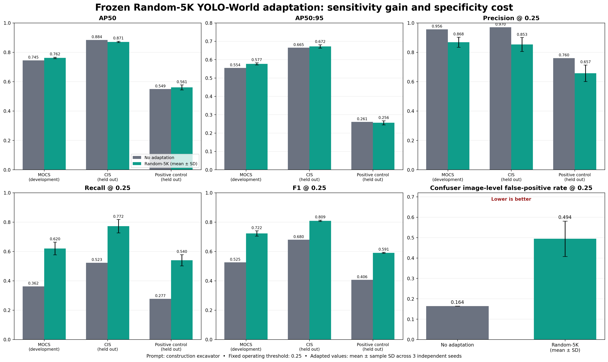
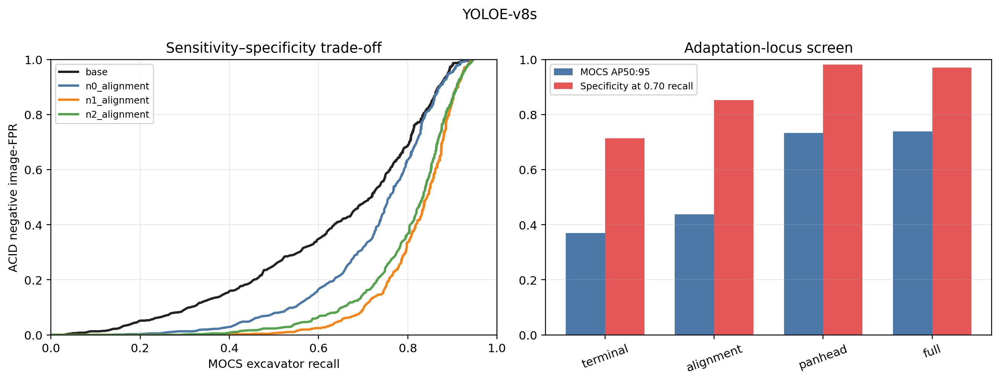
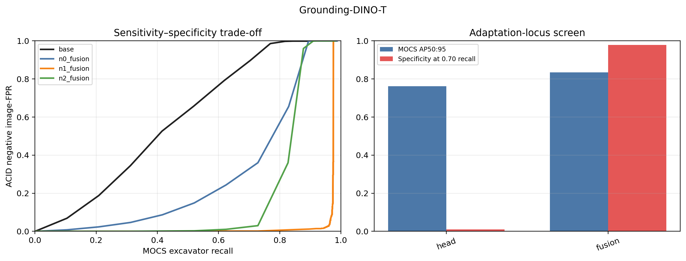
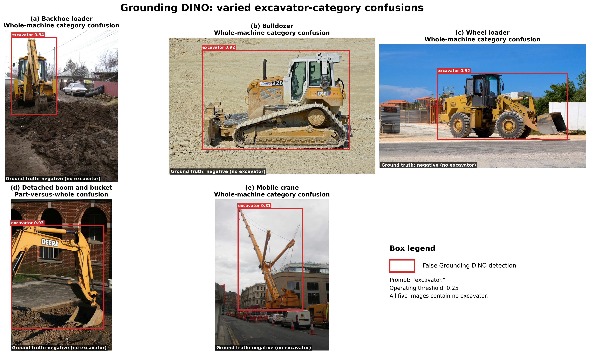
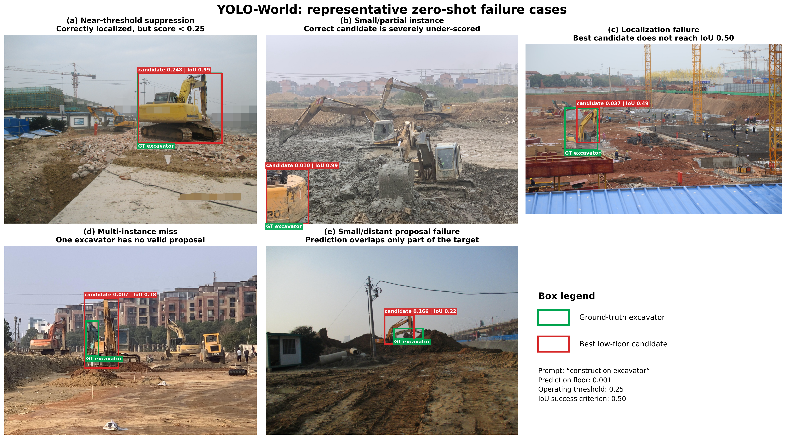
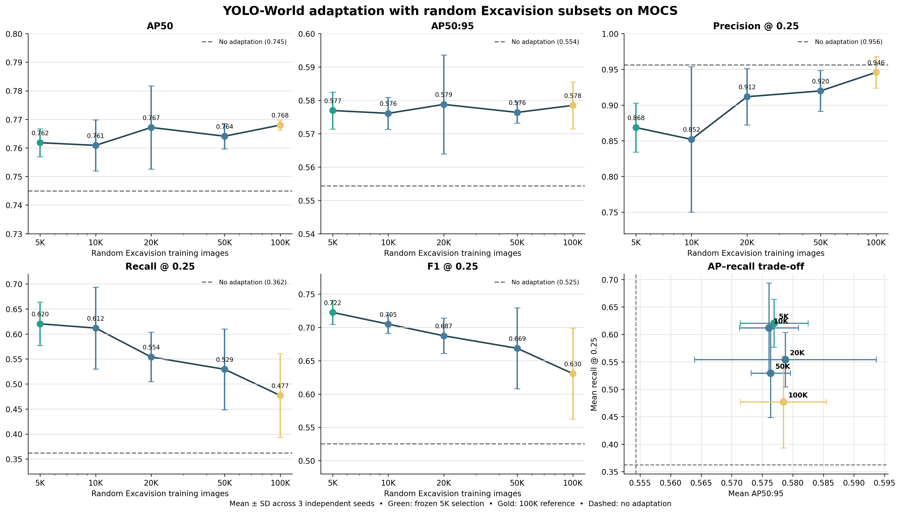
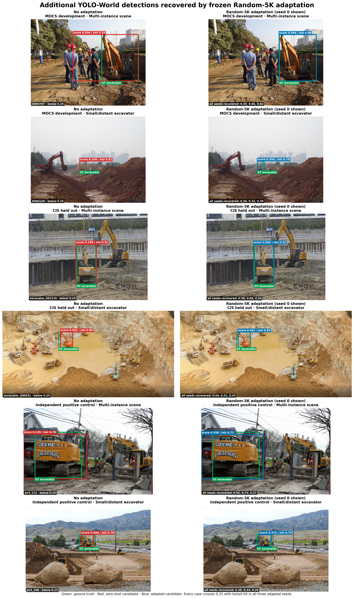

# Excavision for Open-Vocabulary Excavator Detection

This study asks whether controlled synthetic data can improve the performance of
open-vocabulary foundation detectors on a rare industrial category. We evaluated
two widely used models, Grounding DINO and YOLO-World, on real excavator datasets
and tested YOLO-World adaptation with multiple subsets of our one-million-image
Excavision dataset to determine what synthetic supervision improves—and what it
cannot fix by itself.

**Excavision** is a **1.09-million-frame multimodal synthetic benchmark dataset**
for excavator perception, providing controlled variation in machine configuration,
camera viewpoint, articulation, appearance, lighting, and scene conditions together
with aligned annotations. The dataset can be searched interactively by render
condition in the [Excavision Hugging Face Explorer](https://huggingface.co/spaces/Sheida1/excavision-explorer).

The models exhibited different failure modes: Grounding DINO achieved strong
excavator recall but frequently confused related machines and detached components,
whereas YOLO-World often localized excavators correctly but assigned them scores
below the operating threshold. A three-seed subset-size study showed that only
5,000 randomly sampled Excavision images were sufficient to saturate ranking-based
accuracy on MOCS. After this size was frozen, selective YOLO-World adaptation
consistently improved fixed-threshold recall and F1 across three real-image sources,
but did **not** consistently improve AP or confuser rejection—showing that positive
synthetic data improves sensitivity but does not replace negative evidence for
learning a sharper category boundary.



**Interpretation.** Positive-only synthetic adaptation improves excavator recall but
does not reliably sharpen the excavator/non-excavator category boundary. This
outcome is expected because Excavision provides positive excavator supervision but
no realistic hard negatives: the model learns to assign higher confidence to
excavators, but receives no new evidence teaching it to reject backhoe loaders,
wheel loaders, isolated attachments, and other confusing objects.

## Main findings

1. **The two models fail differently.** Grounding DINO has strong excavator recall
   but an overly broad category boundary. YOLO-World is conservative: valid
   excavator boxes often exist at the low prediction floor but score below the
   fixed operating threshold.
2. **YOLO-World's main miss mechanism is confidence, not proposal coverage.** With
   the selected prompt, an IoU≥0.50 candidate exists for 89.1% of MOCS ground-truth
   excavators and 89.8% of the independent positive-control instances. Confidence
   failures account for 51.0% and 65.0% of instances, respectively.
3. **Positive-only Excavision data targets that weakness efficiently.** Across three
   independent seeds, Random-5K score-head adaptation raised recall by +0.258 on
   MOCS, +0.249 on CIS, and +0.263 on the positive control at the locked 0.25
   threshold. Larger positive-only subsets were not needed to obtain the MOCS AP
   benefit and produced lower mean fixed-threshold recall.
4. **The gain is a sensitivity–specificity trade-off, not universal improvement.**
   AP50:95 changed by +0.023, +0.007, and −0.004 on those same datasets. Confuser
   image FPR increased from 0.164 to 0.494±0.086. Positive synthetic images improve
   sensitivity but do not supply the negative evidence needed to sharpen the
   excavator/non-excavator boundary.

## New comprehensive screen: learning the excavator boundary

The positive-only study above motivated a more fundamental question: before adding
Excavision, what real supervision and what adaptation depth are required to teach an
open-vocabulary detector that a backhoe loader, dozer, crane, or wheel loader is
**not** an excavator? We ran a controlled 14-checkpoint development screen with
YOLOE-v8-S and MM-Grounding-DINO-T. Training budgets were matched while negative
images were represented either as background-only examples or as explicitly boxed
and named confuser classes. We separately varied how much of each architecture was
allowed to learn.

The central result is that realistic negative images sharply improve category
specificity, but the best implementation is model-dependent. Background-negative
supervision preserved AP50:95 within 0.02 of the best representation arm for both
families while substantially reducing false positives. YOLOE required PAN+head
adaptation to obtain its strongest sensitivity/specificity trade-off; Grounding
DINO required at least its fusion/detector scope. Low-floor oracle recall remained
high—roughly 0.94–0.96 for YOLOE and 0.97–0.99 for Grounding DINO—showing that the
main issue is candidate scoring and boundary separation rather than a complete lack
of localized proposals.

### YOLOE-v8-S

YOLOE PAN+head reached AP50:95 0.733, AP50 0.881, and recall 0.817 at threshold
0.25, with only 0.018 negative image-FPR when matched to 0.70 MOCS recall. Full
detector adaptation gained only 0.006 AP50:95, used substantially more trainable
parameters, and was slightly worse in recall and matched specificity. PAN+head is
therefore the provisional development scope.



### MM-Grounding-DINO-T

For Grounding DINO, positive-only fusion adaptation reached AP50:95 0.841 but had
0.325 negative image-FPR at matched 0.70 recall. Background-negative adaptation
retained AP50:95 0.833 while reducing matched-recall FPR to 0.001. A configuration
audit also found that the nominal vision+fusion and full runs had silently inherited
the fusion freeze map; they are disclosed as repeated fusion executions, not used as
architectural evidence, and the launcher has been corrected for the required reruns.



These are one-seed development findings, not final held-out claims. No Excavision
image was used in this phase. The study establishes the negative-aware real-data
baseline needed for the next question: whether controlled synthetic positives add
difficult-positive coverage or data efficiency after the category boundary has
already been learned. See the
[full experimental explanation](docs/negative_supervision_phase1.md),
[aggregate results](results/negative_supervision_phase1/), and
[reproducible code](scripts/negative_supervision/).

## Zero-shot benchmark

MOCS was used as the development set; ACID and CIS remained held-out. AP is
threshold-independent. Precision, recall, and F1 use the locked 0.25 operating
threshold. The table below uses the canonical single prompt for each model.

| Model | Dataset | AP50 | AP50:95 | P@0.25 | R@0.25 | F1@0.25 |
|---|---|---:|---:|---:|---:|---:|
| Grounding DINO (`excavator.`) | MOCS | 0.874 | 0.788 | 0.852 | 0.821 | 0.836 |
| Grounding DINO (`excavator.`) | ACID | 0.943 | 0.817 | 0.794 | 0.938 | 0.860 |
| Grounding DINO (`excavator.`) | CIS | 0.968 | 0.899 | 0.813 | 0.960 | 0.881 |
| YOLO-World (`excavator`) | MOCS | 0.723 | 0.537 | 0.963 | 0.231 | 0.373 |
| YOLO-World (`excavator`) | ACID | 0.840 | 0.580 | 0.987 | 0.207 | 0.343 |
| YOLO-World (`excavator`) | CIS | 0.857 | 0.638 | 0.969 | 0.354 | 0.519 |

Prompt selection was performed on MOCS only. The selected YOLO-World prompt,
`construction excavator`, increased held-out recall to 0.336 on ACID and 0.519 on
CIS. Grounding DINO retained `excavator.`. See
[`docs/zero_shot_protocol.md`](docs/zero_shot_protocol.md) for the locked protocol.

## Failure modes

| Model | Evidence | Diagnosed failure | Implication |
|---|---|---|---|
| YOLO-World | IoU≥0.50 candidates cover about 89% of GT, while 51–65% of GT are confidence failures | Text/cross-modal score alignment and calibration dominate missed detections | Adapt scoring/fusion while preserving localization; do not assume the visual proposal system must be relearned |
| Grounding DINO | 86/110 confuser images fire; 80/86 are whole-object category confusions; all 6 isolated attachments fire | Over-broad category boundary plus part/whole confusion | Positive excavator renders alone are insufficient; adaptation requires whole-machine hard negatives and isolated-part counterfactuals |

On the frozen 127-image positive control, Grounding DINO achieved AP50 0.745 and
recall 0.847, while selected-prompt YOLO-World achieved AP50 0.547 and recall 0.248.
On 110 negative/confuser images, Grounding DINO's image false-positive rate was
78.2%; YOLO-World's was 10.9% with the canonical prompt and 14.5% with the selected
prompt. These complementary results explain why a single headline AP value is not
enough. Full diagnostic details are in
[`docs/error_decomposition.md`](docs/error_decomposition.md).

### Qualitative examples

The Grounding DINO panels are drawn from the frozen negative/confuser set. Because
these images contain no excavator, every red box is a false detection and the
ground truth is explicitly marked as negative. The five examples span four
whole-machine confusions and one part-versus-whole confusion.



The YOLO-World panels use MOCS ground-truth boxes (green) and the best candidate
retained at the low prediction floor (red). They separate near-threshold and severe
under-scoring from localization, multi-instance, and small/distant proposal failures.



## YOLO-World adaptation

The adaptation is **selective fine-tuning, not LoRA**. The backbone, neck, and
localization branch were frozen. Training updated the open-vocabulary scoring head
using single-class Excavision positives. The locked recipe used 30 epochs, AdamW,
batch size 64, 640-pixel inputs, and the selected prompt `construction excavator`.

The main size experiment evaluated random 5K, 10K, 20K, 50K, and 100K Excavision
subsets with three independent seeds per size. All 15 checkpoints used the same
training recipe and were evaluated through one identical MOCS development-set
pipeline. Mean AP50 and AP50:95 were effectively saturated across sizes, while
fixed-threshold recall and F1 decreased as the positive-only synthetic budget grew.



The figure reports every locked MOCS metric in one place: AP50, AP50:95,
precision, recall, and F1 at the fixed 0.25 operating threshold, plus the
AP50:95–recall trade-off. Points are means over three independent seeds and error
bars are standard deviations; dashed lines are the unchanged zero-shot baseline.

The frozen rule first maximized mean AP50:95, treated configurations within 0.005
or with overlapping 95% confidence intervals as practically equivalent, then used
mean recall and data efficiency as tie-breakers. It selected **5K**: AP50:95 was
0.577±0.006 and recall was 0.620±0.043. The MOCS evidence therefore supports rapid
saturation and data efficiency, not a monotonic “more synthetic data is better”
claim. The complete selection record and per-seed values are in
[`results/size_selection_multiseed`](results/size_selection_multiseed/).

### Frozen held-out evaluation

After selection, all three Random-5K checkpoints were applied unchanged to CIS,
the independent positive control, and the corrected confuser set. No held-out
result was used to revise the selected size, prompt, or 0.25 operating threshold.


Random-5K increased recall from 0.362 to 0.620±0.043 on MOCS, from 0.523 to
0.772±0.046 on CIS, and from 0.277 to 0.540±0.038 on the positive control. AP50:95
changed from 0.554 to 0.577±0.006, 0.665 to 0.672±0.009, and 0.261 to
0.256±0.011, respectively. Confuser image FPR increased from 0.164 to 0.494±0.086.
The supported claim is therefore a strong fixed-threshold sensitivity and F1 gain,
not universal AP improvement or improved specificity.

Exact mean/std values, all per-seed measurements, and the integrity record are in
[`results/final_selected_5k`](results/final_selected_5k/). The audit verified three
unique checkpoint hashes, three unique prediction hashes for every held-out
dataset, and identical locked inference configurations across seeds.

### Detections recovered after adaptation

The additional examples below were extracted with a fixed rule: the no-adaptation
model had an IoU≥0.50 candidate below the 0.25 operating threshold, while every one
of the three Random-5K seeds produced an IoU≥0.50 detection at or above 0.25. Seed
0 is shown for visual comparison; the caption in each adapted panel reports all
three scores.
These are illustrative cases consistent with the aggregate recall result, not an
additional independent evaluation.



Selection provenance and exact image identifiers are recorded in
[`selected_random5k_recovery_manifest.csv`](results/failure_cases/selected_random5k_recovery_manifest.csv).
The earlier qualitative composites remain available in
[`results/failure_cases`](results/failure_cases/) and were not removed. The new
figure can be regenerated locally with
[`build_selected_5k_recovery_examples.py`](scripts/visualization/build_selected_5k_recovery_examples.py)
when the private datasets and prediction files are available.

## Grounding DINO adaptation — future work

No Grounding DINO fine-tuning result is claimed here. Its principal weakness in our
evaluation was not failure to find excavators, but an overly broad decision boundary:
the model frequently labelled visually related construction machines and detached
excavator components as complete excavators. Improving performance therefore means
reducing these false positives while preserving its already strong excavator recall.

This correction requires **realistic hard-negative supervision**—images that contain
confusing non-excavator machines or excavator-like parts but contain no valid
excavator instance. Excavision currently provides positive excavator renders and
does not contain realistic examples of these negative categories. Additional
positive synthetic excavators alone therefore cannot teach the model where the
excavator/non-excavator boundary should lie.

Future work will collect a separate, adaptation-only negative dataset containing:

- whole-machine confusers such as backhoe loaders, wheel loaders, bulldozers,
  cranes, trucks, and other construction equipment;
- isolated buckets, booms, arms, and attachments to address part-versus-whole
  confusion; and
- construction-site clutter and equipment-free scenes to measure background
  rejection.

These negatives should be combined with Excavision positives and adapted through a
lightweight strategy targeting Grounding DINO's region–text alignment or detection
head, rather than immediately fine-tuning the complete backbone. The protocol must
be frozen before accessing the held-out evaluations and should measure the trade-off
between excavator recall and confuser false-positive rate, as well as duplicate or
fragmented detections and retention on general open-vocabulary categories. This
would test whether positive synthetic coverage and realistic negative boundary
supervision provide complementary benefits.

## Repository contents

```text
configs/                 Locked prompts and operating settings
data/                    Empty placeholders; no datasets are distributed
docs/                    Evaluation, adaptation, and error-analysis protocols
results/                 Accepted aggregate tables and publication figures
scripts/evaluation/      Zero-shot inference and common single-class evaluation
scripts/adaptation/      Selective YOLO-World training and evaluation
scripts/visualization/   Reproducible qualitative failure/recovery figures
```

## Reproducing the workflow

Install dependencies in a CUDA-compatible Python environment, arrange the private
data as described in [`data/README.md`](data/README.md), and obtain the upstream
model weights.

```bash
pip install -r requirements.txt

python scripts/evaluation/run_yolo_world.py \
  --model yolov8s-worldv2.pt --images_dir data/mocs/images \
  --prompt "construction excavator" --conf 0.001 \
  --out_json predictions/yolo_world_mocs.json

python scripts/evaluation/run_grounding_dino.py \
  --images_dir data/mocs/images --prompt "excavator." \
  --box_thr 0.01 --text_thr 0.01 \
  --out_json predictions/grounding_dino_mocs.json

python scripts/adaptation/train_yolo_world.py \
  --model yolov8s-worldv2.pt --arm score_head --device 0 \
  --train-list data/excavision/train.txt --expected-images 5000 \
  --val-images data/mocs/images --epochs 30 --batch 64 --seed 0
```

The exact study settings are recorded in [`configs/study.yaml`](configs/study.yaml).
Datasets, checkpoints, and raw prediction files are excluded from version control.

## Scope and responsible interpretation

This is a single-category industrial-domain study. It supports a claim about
synthetic positive supervision improving YOLO-World's excavator sensitivity under a
locked protocol. It does not establish improved general open-vocabulary performance,
better calibration in the formal probabilistic sense, or a corrected category
boundary. Those require general-category retention tests and negative supervision.

## Upstream models

- [Grounding DINO](https://github.com/IDEA-Research/GroundingDINO)
- [YOLO-World](https://github.com/AILab-CVC/YOLO-World)

Please cite the upstream model papers and the Excavision dataset/paper when using
this experiment. A project-specific citation entry will be added with publication.
