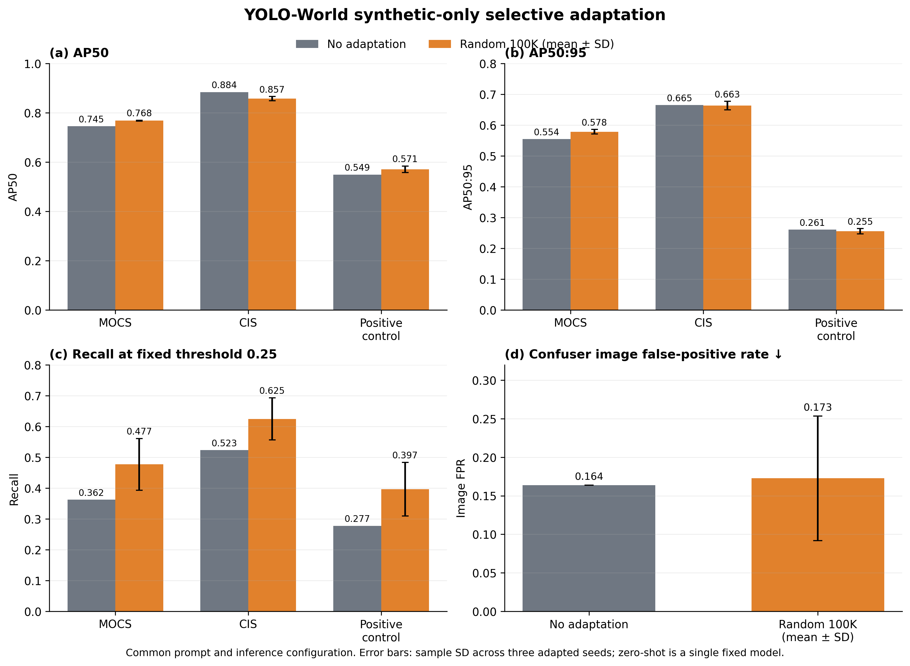
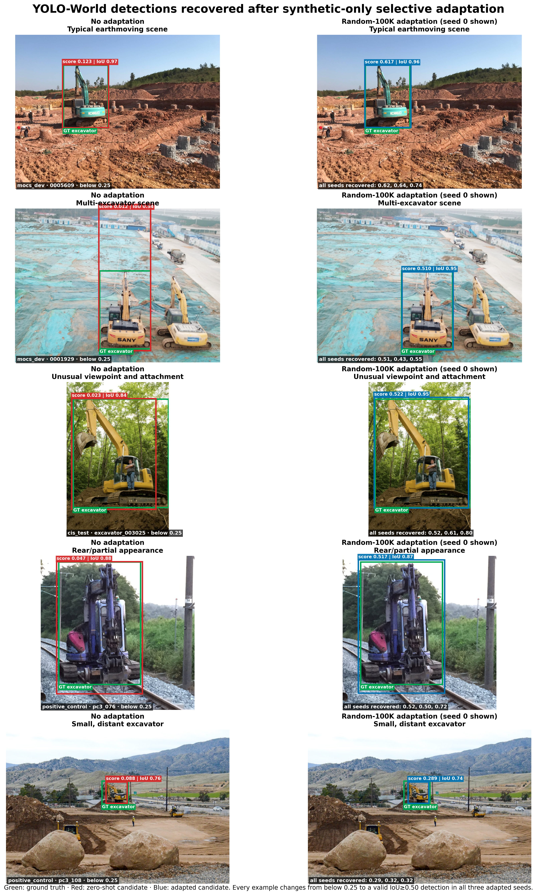

# Excavision for Open-Vocabulary Excavator Detection

This study asks whether controlled synthetic data can improve the performance of
open-vocabulary foundation detectors on a rare industrial category. We evaluated
two widely used models, Grounding DINO and YOLO-World, on real excavator datasets
and tested YOLO-World adaptation with multiple subsets of our one-million-image
Excavision dataset to determine what synthetic supervision improves—and what it
cannot fix by itself.

**Excavision** is a **1.09-million-frame multimodal synthetic benchmark dataset**
for excavator perception, providing controlled variation in machine configuration,
camera viewpoint, articulation, appearance, lighting, and scene conditions together
with aligned annotations. The dataset can be searched interactively by render
condition in the [Excavision Hugging Face Explorer](https://huggingface.co/spaces/Sheida1/excavision-explorer).

The models exhibited different failure modes: Grounding DINO achieved strong
excavator recall but frequently confused related machines and detached components,
whereas YOLO-World often localized excavators correctly but assigned them scores
below the operating threshold. Selective YOLO-World adaptation with 100,000
randomly sampled Excavision images consistently improved fixed-threshold recall and
F1 across three real-image sources, but did **not** consistently improve AP or
confuser rejection—showing that positive synthetic data improves sensitivity but
does not replace negative evidence for learning a sharper category boundary.



## Main findings

1. **The two models fail differently.** Grounding DINO has strong excavator recall
   but an overly broad category boundary. YOLO-World is conservative: valid
   excavator boxes often exist at the low prediction floor but score below the
   fixed operating threshold.
2. **YOLO-World's main miss mechanism is confidence, not proposal coverage.** With
   the selected prompt, an IoU≥0.50 candidate exists for 89.1% of MOCS ground-truth
   excavators and 89.8% of the independent positive-control instances. Confidence
   failures account for 51.0% and 65.0% of instances, respectively.
3. **Positive-only Excavision data targets that weakness.** Across three independent
   seeds, score-head adaptation raised recall by +0.115 on MOCS, +0.102 on CIS, and
   +0.119 on the positive control at the locked 0.25 threshold.
4. **The gain is not universal detector improvement.** AP50:95 changed by +0.024,
   −0.002, and −0.005 on those same datasets. Confuser image FPR changed from 0.164
   to 0.173±0.081. Positive synthetic images improve sensitivity but do not supply
   the negative evidence needed to sharpen the excavator/non-excavator boundary.

## Zero-shot benchmark

MOCS was used as the development set; ACID and CIS remained held-out. AP is
threshold-independent. Precision, recall, and F1 use the locked 0.25 operating
threshold. The table below uses the canonical single prompt for each model.

| Model | Dataset | AP50 | AP50:95 | P@0.25 | R@0.25 | F1@0.25 |
|---|---|---:|---:|---:|---:|---:|
| Grounding DINO (`excavator.`) | MOCS | 0.874 | 0.788 | 0.852 | 0.821 | 0.836 |
| Grounding DINO (`excavator.`) | ACID | 0.943 | 0.817 | 0.794 | 0.938 | 0.860 |
| Grounding DINO (`excavator.`) | CIS | 0.968 | 0.899 | 0.813 | 0.960 | 0.881 |
| YOLO-World (`excavator`) | MOCS | 0.723 | 0.537 | 0.963 | 0.231 | 0.373 |
| YOLO-World (`excavator`) | ACID | 0.840 | 0.580 | 0.987 | 0.207 | 0.343 |
| YOLO-World (`excavator`) | CIS | 0.857 | 0.638 | 0.969 | 0.354 | 0.519 |

Prompt selection was performed on MOCS only. The selected YOLO-World prompt,
`construction excavator`, increased held-out recall to 0.336 on ACID and 0.519 on
CIS. Grounding DINO retained `excavator.`. See
[`docs/zero_shot_protocol.md`](docs/zero_shot_protocol.md) for the locked protocol.

## Failure modes

| Model | Evidence | Diagnosed failure | Implication |
|---|---|---|---|
| YOLO-World | IoU≥0.50 candidates cover about 89% of GT, while 51–65% of GT are confidence failures | Text/cross-modal score alignment and calibration dominate missed detections | Adapt scoring/fusion while preserving localization; do not assume the visual proposal system must be relearned |
| Grounding DINO | 86/110 confuser images fire; 80/86 are whole-object category confusions; all 6 isolated attachments fire | Over-broad category boundary plus part/whole confusion | Positive excavator renders alone are insufficient; adaptation requires whole-machine hard negatives and isolated-part counterfactuals |

On the frozen 127-image positive control, Grounding DINO achieved AP50 0.745 and
recall 0.847, while selected-prompt YOLO-World achieved AP50 0.547 and recall 0.248.
On 110 negative/confuser images, Grounding DINO's image false-positive rate was
78.2%; YOLO-World's was 10.9% with the canonical prompt and 14.5% with the selected
prompt. These complementary results explain why a single headline AP value is not
enough. Full diagnostic details are in
[`docs/error_decomposition.md`](docs/error_decomposition.md).

### Qualitative examples

The Grounding DINO panels are drawn from the frozen negative/confuser set. Because
these images contain no excavator, every red box is a false detection and the
ground truth is explicitly marked as negative. The five examples span four
whole-machine confusions and one part-versus-whole confusion.


The YOLO-World panels use MOCS ground-truth boxes (green) and the best candidate
retained at the low prediction floor (red). They separate near-threshold and severe
under-scoring from localization, multi-instance, and small/distant proposal failures.


## YOLO-World adaptation

The adaptation is **selective fine-tuning, not LoRA**. The backbone, neck, and
localization branch were frozen. Training updated the open-vocabulary scoring head
using single-class Excavision positives. The locked recipe used 30 epochs, AdamW,
batch size 64, 640-pixel inputs, and the selected prompt `construction excavator`.

An exploratory seed-0 scale sweep compared 5K, 20K, 100K, and 500K random subsets.
The curve was non-monotonic: 5K and 100K gave similar MOCS gains, so the experiment
does not support a “more synthetic data is always better” claim. The 100K condition
was frozen before confirmatory multi-seed evaluation. Curated subsets were also
audited internally but showed no consistent advantage and are not part of the main
claim.

### Accepted three-seed results

The publication figure above contains the complete no-adaptation versus Random-100K
comparison for AP50, AP50:95, recall, and confuser false-positive rate, so those
values are not duplicated in a second Markdown table. Exact values and all per-seed
measurements remain available in
[`final_figure_data.csv`](results/final_multiseed/final_figure_data.csv) and
[`per_seed_results.csv`](results/final_multiseed/per_seed_results.csv).

The final integrity audit verified 3/3 unique model-tensor hashes and 3/3 unique
prediction hashes for every evaluated dataset. The accepted outputs are under
[`results/final_multiseed`](results/final_multiseed/). Two earlier multi-seed attempts
were rejected after discovering identical effective data-order trajectories; they
are intentionally excluded from this repository.

### Detections recovered after adaptation

The examples below were extracted with a fixed rule: the no-adaptation model had an
IoU≥0.50 candidate below the 0.25 operating threshold, while every one of the three
Random-100K seeds produced an IoU≥0.50 detection at or above 0.25. Seed 0 is shown
for visual comparison; the caption in each adapted panel reports all three scores.
These are illustrative cases consistent with the aggregate recall result, not an
additional independent evaluation.



Selection provenance and exact image identifiers are recorded in
[`failure_case_manifest.csv`](results/failure_cases/failure_case_manifest.csv). The
figures can be regenerated locally with
[`build_failure_case_figures.py`](scripts/visualization/build_failure_case_figures.py)
when the private datasets and prediction files are available.

## Grounding DINO adaptation — future work

No Grounding DINO fine-tuning result is claimed here. Its principal weakness in our
evaluation was not failure to find excavators, but an overly broad decision boundary:
the model frequently labelled visually related construction machines and detached
excavator components as complete excavators. Improving performance therefore means
reducing these false positives while preserving its already strong excavator recall.

This correction requires **realistic hard-negative supervision**—images that contain
confusing non-excavator machines or excavator-like parts but contain no valid
excavator instance. Excavision currently provides positive excavator renders and
does not contain realistic examples of these negative categories. Additional
positive synthetic excavators alone therefore cannot teach the model where the
excavator/non-excavator boundary should lie.

Future work will collect a separate, adaptation-only negative dataset containing:

- whole-machine confusers such as backhoe loaders, wheel loaders, bulldozers,
  cranes, trucks, and other construction equipment;
- isolated buckets, booms, arms, and attachments to address part-versus-whole
  confusion; and
- construction-site clutter and equipment-free scenes to measure background
  rejection.

These negatives should be combined with Excavision positives and adapted through a
lightweight strategy targeting Grounding DINO's region–text alignment or detection
head, rather than immediately fine-tuning the complete backbone. The protocol must
be frozen before accessing the held-out evaluations and should measure the trade-off
between excavator recall and confuser false-positive rate, as well as duplicate or
fragmented detections and retention on general open-vocabulary categories. This
would test whether positive synthetic coverage and realistic negative boundary
supervision provide complementary benefits.

## Repository contents

```text
configs/                 Locked prompts and operating settings
data/                    Empty placeholders; no datasets are distributed
docs/                    Evaluation, adaptation, and error-analysis protocols
results/                 Accepted aggregate tables and publication figures
scripts/evaluation/      Zero-shot inference and common single-class evaluation
scripts/adaptation/      Selective YOLO-World training and evaluation
scripts/visualization/   Reproducible qualitative failure/recovery figures
```

## Reproducing the workflow

Install dependencies in a CUDA-compatible Python environment, arrange the private
data as described in [`data/README.md`](data/README.md), and obtain the upstream
model weights.

```bash
pip install -r requirements.txt

python scripts/evaluation/run_yolo_world.py \
  --model yolov8s-worldv2.pt --images_dir data/mocs/images \
  --prompt "construction excavator" --conf 0.001 \
  --out_json predictions/yolo_world_mocs.json

python scripts/evaluation/run_grounding_dino.py \
  --images_dir data/mocs/images --prompt "excavator." \
  --box_thr 0.01 --text_thr 0.01 \
  --out_json predictions/grounding_dino_mocs.json

python scripts/adaptation/train_yolo_world.py \
  --model yolov8s-worldv2.pt --arm score_head --device 0 \
  --train-list data/excavision/train.txt --expected-images 100000 \
  --val-images data/mocs/images --epochs 30 --batch 64 --seed 0
```

The exact study settings are recorded in [`configs/study.yaml`](configs/study.yaml).
Datasets, checkpoints, and raw prediction files are excluded from version control.

## Scope and responsible interpretation

This is a single-category industrial-domain study. It supports a claim about
synthetic positive supervision improving YOLO-World's excavator sensitivity under a
locked protocol. It does not establish improved general open-vocabulary performance,
better calibration in the formal probabilistic sense, or a corrected category
boundary. Those require general-category retention tests and negative supervision.

## Upstream models

- [Grounding DINO](https://github.com/IDEA-Research/GroundingDINO)
- [YOLO-World](https://github.com/AILab-CVC/YOLO-World)

Please cite the upstream model papers and the Excavision dataset/paper when using
this experiment. A project-specific citation entry will be added with publication.
