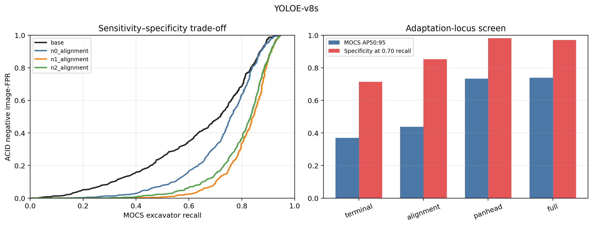
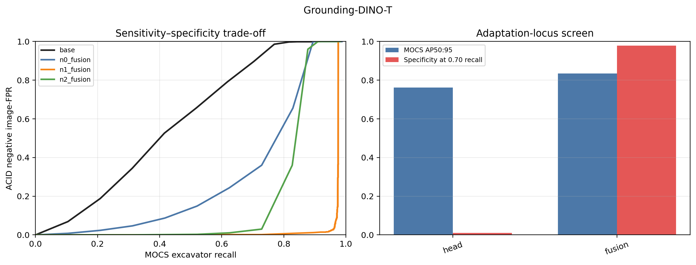
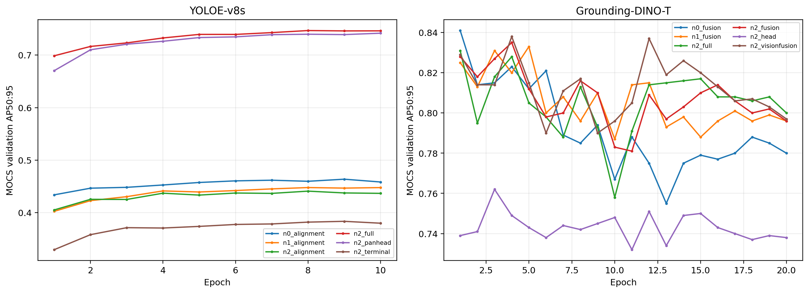
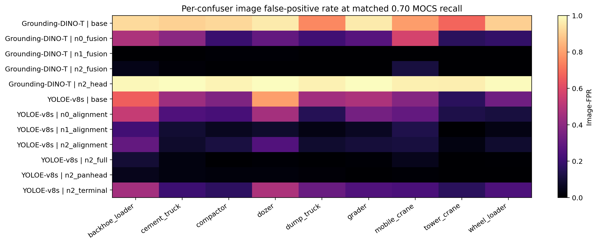

# Teaching open-vocabulary detectors what is *not* an excavator

## Why we ran this study

Our earlier experiments showed that positive Excavision images can make an
open-vocabulary detector more willing to report excavators. That is useful for
recall, but it leaves an important unanswered question: does the model actually
learn a better excavator concept, or does it simply become more confident around
anything that resembles yellow construction equipment?

This distinction matters in construction automation. A detector that finds more
excavators but also labels backhoe loaders, bulldozers, cranes, or detached buckets
as excavators has not learned a safe category boundary. Accuracy on positive images
alone cannot reveal this problem.

We therefore designed a comprehensive development screen around two complementary
requirements:

1. **Sensitivity:** continue detecting and localizing excavators in real images.
2. **Specificity:** reject visually related construction equipment that is not an
   excavator.

The purpose of this stage was to determine what kind of negative supervision is
needed and which parts of each model must be updated. It deliberately used real
ACID data only. No Excavision image was used in these runs; this establishes the
real-data boundary-learning baseline against which synthetic positives will be
tested next.

## Models

We screened two trainable open-vocabulary detector families:

- **YOLOE-v8-S**, a compact detector with an open-vocabulary alignment pathway and
  conventional multi-scale detection head.
- **MM-Grounding-DINO-T**, a Grounding-DINO implementation with a Swin-T image
  backbone and cross-modal fusion between text and image features.

These models are not treated as interchangeable. Their score scales, adaptation
interfaces, and failure modes differ, so every main result is reported separately.

## Experimental design

### Three ways to present negative information

All training arms used exactly 10,000 image exposures and the same optimizer budget.
This prevents a larger dataset or longer training schedule from masquerading as a
better supervision strategy.

| Arm | Training composition | What it tests |
|---|---|---|
| **N0: positive only** | 10,000 real excavator exposures | What happens when the model only sees evidence for “excavator”? |
| **N1: background negatives** | 5,000 excavator + 5,000 non-excavator exposures; negative images have no excavator box | Is simple “there is no excavator here” supervision sufficient? |
| **N2: explicit confusers** | Same images and budget as N1, but every non-excavator machine has its own box and class name | Do semantic labels such as `backhoe_loader` or `dozer` sharpen the boundary beyond background supervision? |

The negative pool contained nine real construction-equipment classes: backhoe
loader, cement truck, compactor, dozer, dump truck, grader, mobile crane, tower
crane, and wheel loader. Close confusers—backhoe loaders, dozers, and wheel
loaders—were deliberately represented.

### Adaptation-scope screen

We also varied how much of each detector was allowed to learn.

- YOLOE: terminal fixed-vocabulary head, open alignment layers, PAN+head, and the
  full detector scope.
- Grounding DINO: prediction head, official fusion/detector scope, intended
  vision+fusion scope, and intended full model.

The objective was not “fine-tune as many parameters as possible.” We wanted the
smallest intervention that preserved positive-image AP while improving rejection
of confusers.

### Development evaluation

- **MOCS:** 1,010 positive images with 1,452 excavator boxes, used to measure AP and
  recall.
- **ACID development negatives:** 772 negative-only images containing 956
  non-excavator equipment boxes, used to measure false positives.
- **Prompt:** the single canonical concept `excavator`.
- **Prediction floor:** 0.001, allowing us to examine candidates hidden below the
  normal operating threshold.

CIS, the frozen positive control, the frozen external-confuser set, and the
controlled-occlusion set were not accessed. This is a development screen, not a
held-out confirmation.

## Why one threshold is not enough

A score of 0.25 does not mean exactly the same thing after every kind of
adaptation. Some runs shift all scores upward or downward without changing the
underlying ranking much. We therefore report:

- AP50 and AP50:95, which do not depend on choosing one score threshold;
- precision, recall, and F1 at the historical threshold of 0.25;
- the complete recall-versus-negative-FPR curve; and
- negative image-FPR when every model is matched to the same 0.70 MOCS recall.

The matched-recall comparison is especially important: each model must deliver the
same positive sensitivity before we ask which one rejects more confusers.

## YOLOE-v8-S results

### Negative representation

| Training arm | AP50:95 | AP50 | Recall @0.25 | Negative image-FPR @0.25 | FPR at matched 0.70 recall |
|---|---:|---:|---:|---:|---:|
| N0 positive only | **0.460** | 0.729 | **0.729** | 0.389 | 0.316 |
| N1 background negatives | 0.444 | 0.715 | 0.715 | **0.122** | **0.095** |
| N2 explicit confusers | 0.438 | 0.716 | 0.689 | 0.124 | 0.148 |

Positive-only alignment adaptation made YOLOE much more sensitive, but also much
more permissive: at threshold 0.25, 38.9% of negative images fired. Adding
background negatives reduced this to 12.2%, while AP50:95 fell by only 0.016.

At this narrow alignment scope, explicit class names did not outperform background
negatives. N2 lost 0.006 AP50:95 and had 5.3 percentage points higher FPR at
matched recall than N1. This does **not** prove that semantic labels are useless;
it shows that they provided no measurable advantage under this particular update
scope and seed.

### Which YOLOE layers need to learn?

| N2 adaptation scope | Updated parameters | AP50:95 | AP50 | Recall @0.25 | FPR at matched 0.70 recall |
|---|---:|---:|---:|---:|---:|
| Terminal head | 3,870 (0.03%) | 0.369 | 0.653 | 0.638 | 0.286 |
| Open alignment | 3.25M (22.0%) | 0.438 | 0.716 | 0.689 | 0.148 |
| **PAN + head** | **7.83M (53.1%)** | 0.733 | **0.881** | **0.817** | **0.018** |
| Full detector | 12.91M (87.5%) | **0.739** | 0.868 | 0.793 | 0.030 |

The narrow heads were not sufficient. The strong change occurred when the
multi-scale PAN features and detection head could adapt together. Full-detector
training gained only 0.006 AP50:95 over PAN+head, but used substantially more
parameters and had slightly lower recall and specificity. Under the locked
development rule, **PAN+head is the provisional YOLOE scope**.

### Remaining YOLOE confusions

At matched 0.70 recall, PAN+head's image-FPR was:

| Confuser | Image-FPR |
|---|---:|
| Backhoe loader | 5.4% |
| Cement truck | 2.7% |
| Dozer | 2.1% |
| Compactor | 2.0% |
| Dump truck | 1.3% |
| Mobile crane | 1.0% |
| Grader, tower crane, wheel loader | 0% |

Backhoe loaders are the clearest remaining class-boundary problem for this model.

## Grounding DINO-T results

### Negative representation

| Training arm | AP50:95 | AP50 | Recall @0.25 | Negative image-FPR @0.25 | FPR at matched 0.70 recall |
|---|---:|---:|---:|---:|---:|
| N0 positive only | **0.841** | **0.935** | **0.871** | 0.926 | 0.325 |
| **N1 background negatives** | 0.833 | 0.932 | 0.860 | **0.010** | **0.001** |
| N2 explicit confusers | 0.835 | 0.932 | 0.860 | 0.815 | 0.022 |

Grounding DINO provides the clearest evidence that positive AP and category
specificity are different questions. N0 had the highest AP50:95, but still fired
on most negative images at the historical threshold. N1 retained nearly all of
the positive AP while reducing matched-recall FPR from 32.5% to 0.1%.

N2 was also strong at a matched operating point, but its raw score scale shifted:
its FPR was 81.5% at threshold 0.25 and 2.2% when matched to 0.70 recall. This is
why we do not compare architectures or adaptation arms using threshold 0.25 alone.

### Adaptation scope and audit finding

The valid head-only run updated 1.13M parameters and obtained AP50:95 0.762, but
its FPR at matched 0.70 recall was 99.0%. The official fusion/detector scope
updated 36.50M parameters, reached AP50:95 0.835, and reduced matched-recall FPR to
2.2%. Updating the prediction head alone therefore did not move the boundary
reliably; cross-modal/detector fusion had to adapt.

During analysis, we found that the runs named `visionfusion` and `full` inherited
the base configuration's backbone freeze. After normalizing the output directory,
their configurations were identical to `fusion`, and all three updated exactly
36.50M parameters. We therefore report them only as repeated executions of the
fusion configuration—not as architectural ablations.

The repeated executions varied from 0.831 to 0.838 AP50:95 and from 0.8% to 8.7%
matched-recall FPR. This variability is itself useful: one execution is not enough
for a general specificity claim. The launcher has been corrected, but the intended
vision+fusion and full experiments remain to be run.

## Findings shared by both models

### 1. The detectors usually already propose an excavator box

Oracle recall at IoU≥0.50 was approximately 0.94–0.96 for YOLOE and 0.97–0.99
for Grounding DINO. Most failures are therefore not caused by a total absence of a
localized candidate. The larger problem is how candidates are scored, separated
from confusers, and refined.

### 2. Positive-only training does not teach rejection

Showing a model more excavators answers “what should score higher?” but not “what
looks similar and must score lower?” This explains why positive-only adaptation can
increase recall and simultaneously worsen false positives.

### 3. Background negatives are a strong baseline

For both model families, simple negative images preserved AP within 0.02 of the
best representation arm while greatly improving specificity. Any more complicated
negative-labeling strategy should be required to beat this inexpensive baseline.

### 4. Adaptation locus matters as much as data labels

YOLOE needed PAN+head adaptation, while Grounding DINO needed at least its
fusion/detector scope. “Fine-tuned with negatives” is not a complete method
description—the updated layers materially change the outcome.

### 5. Early-stopping behavior differs

YOLOE's best checkpoints appeared at epochs 8–10 and were stable at the end of
training. Grounding DINO peaked at epochs 1–5 and lost 0.024–0.061 AP50:95 by epoch
20. Grounding DINO therefore needs stricter development-only checkpoint selection
and should not be judged only from the last epoch.

### 6. Confuser behavior must be reported class by class

The same aggregate FPR can hide different operational risks. Backhoe loaders are
the dominant residual for YOLOE PAN+head, whereas Grounding DINO N1 nearly
eliminated all nine ACID development confusers at 0.70 recall. These results still
require independent-seed and external-set confirmation.

## What can and cannot be claimed now

Supported on development data:

- Real negative images materially sharpen the excavator/non-excavator boundary.
- Background-negative supervision is an unexpectedly strong and efficient control.
- Head-only adaptation is insufficient for these model families.
- YOLOE PAN+head provides the strongest observed efficiency/performance trade-off.
- Matched operating points are necessary because adaptation changes score scales.

Not yet supported:

- That Excavision improves the negative-aware baseline; Excavision was not used in
  this phase.
- That N1 is always better than semantic N2 labels across adaptation scopes.
- That any result generalizes to CIS or the frozen confuser/positive-control sets.
- That the results are stable across independent training seeds.
- That Grounding DINO vision+fusion or full adaptation has been evaluated.
- That open-vocabulary performance on general categories is retained.

## Development decisions and next experiment

The locked rule provisionally selected N1 background negatives for both default
model scopes and YOLOE PAN+head within the N2 scope screen. Those choices come from
different axes, so they must not be combined without evidence.

The immediate crossover experiment is:

1. train YOLOE N0-PAN+head;
2. train YOLOE N1-PAN+head; and
3. compare both with the existing N2-PAN+head checkpoint.

This reveals whether the strong PAN+head result comes from broader adaptation,
semantic confuser labels, or their interaction. In parallel, the corrected
Grounding DINO vision+fusion and full scopes must be completed.

Only after freezing a valid real-positive + real-negative baseline should
Excavision be added. The central next question is then clean and meaningful:

> Given a detector that has already learned the real excavator/non-excavator
> boundary, does controlled synthetic excavator coverage improve real-world
> sensitivity, difficult-positive performance, or data efficiency without
> sacrificing specificity?

## Reproducibility files

Aggregate results and figures are in
[`results/negative_supervision_phase1`](../results/negative_supervision_phase1/).
The executable data preparation, training, inference, and analysis code is in
[`scripts/negative_supervision`](../scripts/negative_supervision/). Private images,
raw predictions, and model checkpoints are not distributed.
