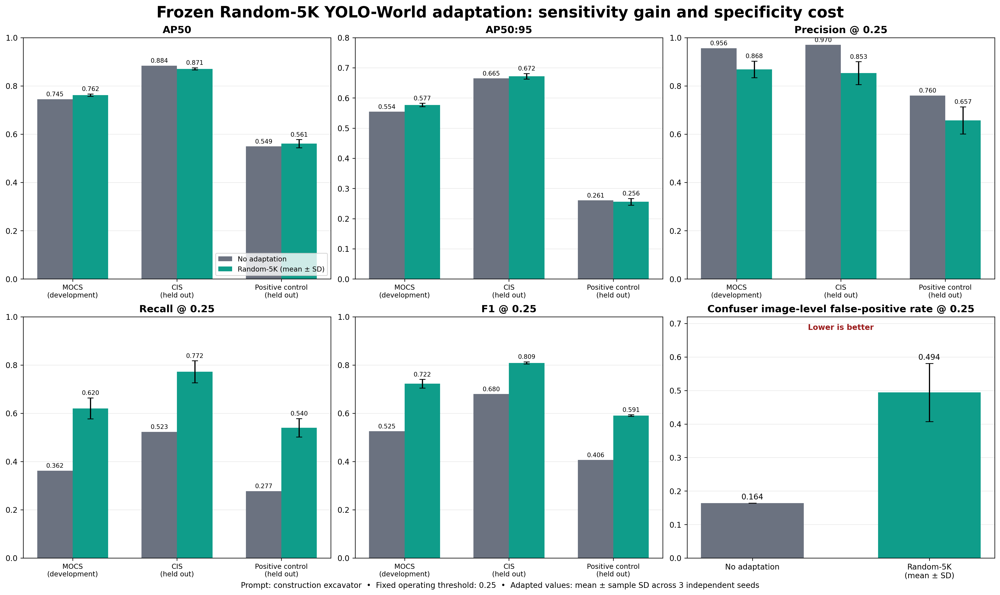

# Frozen Random-5K YOLO-World result

Random-5K was selected using MOCS only, then frozen. CIS, the independent positive control, and the confuser set were evaluated once without changing the prompt, inference settings, or operating threshold. Adapted values are mean ± sample standard deviation across seeds 0, 1, and 2.

| Dataset | Model | AP50 | AP50:95 | P@0.25 | R@0.25 | F1@0.25 |
|---|---|---:|---:|---:|---:|---:|
| MOCS (development) | No adaptation | 0.745 | 0.554 | 0.956 | 0.362 | 0.525 |
| MOCS (development) | Random-5K | 0.762 ± 0.005 | 0.577 ± 0.006 | 0.868 ± 0.034 | 0.620 ± 0.043 | 0.722 ± 0.018 |
| CIS (held out) | No adaptation | 0.884 | 0.665 | 0.970 | 0.523 | 0.680 |
| CIS (held out) | Random-5K | 0.871 ± 0.004 | 0.672 ± 0.009 | 0.853 ± 0.048 | 0.772 ± 0.046 | 0.809 ± 0.005 |
| Positive control (held out) | No adaptation | 0.549 | 0.261 | 0.760 | 0.277 | 0.406 |
| Positive control (held out) | Random-5K | 0.561 ± 0.017 | 0.256 ± 0.011 | 0.657 ± 0.056 | 0.540 ± 0.038 | 0.591 ± 0.003 |

## Confuser specificity

| Model | Image FPR @ 0.25 | False predictions / 100 images |
|---|---:|---:|
| No adaptation | 0.164 | 16.4 |
| Random-5K | 0.494 ± 0.086 | 57.9 ± 14.1 |

## Interpretation

Positive-only Excavision adaptation substantially increases recall at the fixed operating point on all three positive-image sources. Ranking-based AP is not uniformly improved: MOCS improves, CIS AP50 decreases while AP50:95 is approximately unchanged, and positive-control AP changes only slightly. The confuser false-positive rate increases markedly. The supported claim is therefore a targeted sensitivity/confidence benefit, not universal detection improvement or a sharper excavator/non-excavator boundary.

The result also shows rapid data saturation: 5K images are AP-equivalent to larger synthetic subsets on MOCS while providing the best mean recall among the equivalent candidates. More positive data alone does not solve specificity; realistic hard negatives are required for that objective.
